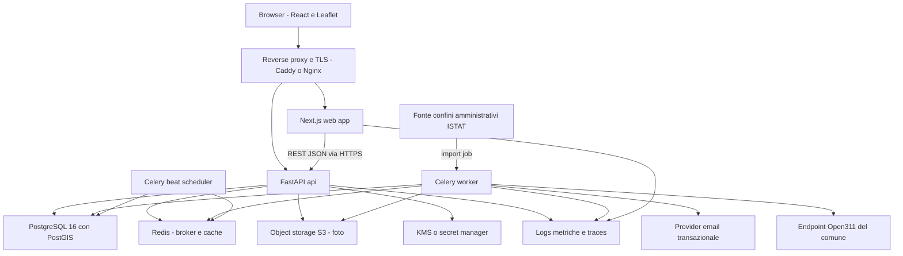
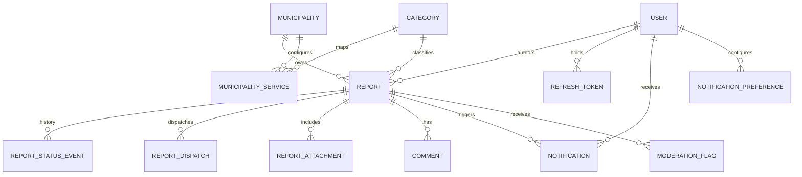
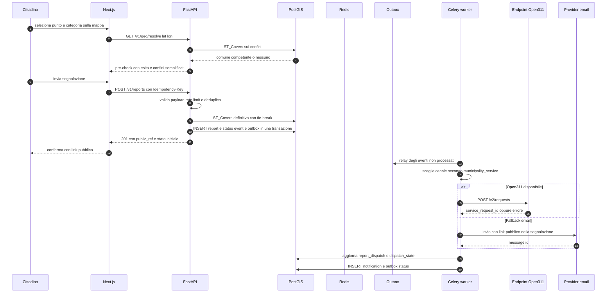
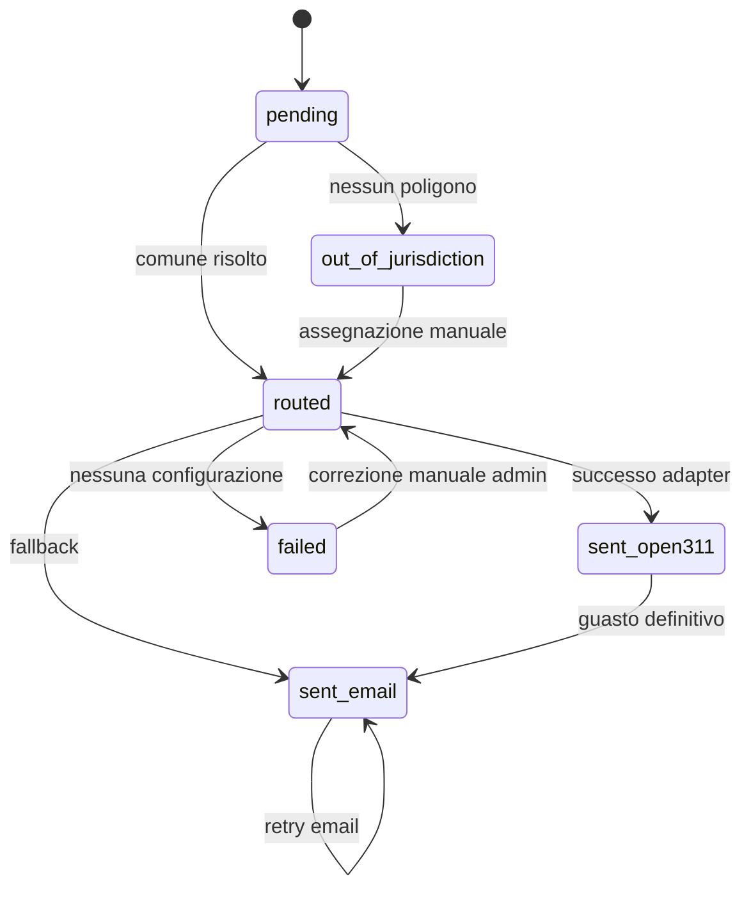
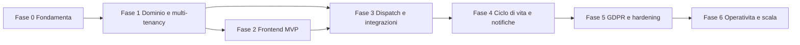

# Piano di implementazione — Piattaforma di segnalazione civica multi-comune

> Documento di architettura. Nessun codice. Destinatari: implementatori, DPO, responsabili dei comuni coinvolti.
> Stato: bozza per revisione. Versionamento: ogni modifica sostanziale aggiunge una voce in fondo.

Indice

1. Decisioni architetturali chiave (ADR sintetiche)
2. Architettura dei componenti e dipendenze
3. Modello di multi-tenancy: scelta e motivazione
4. Modello dati preliminare
5. Flusso di routing e dispatch di una segnalazione
6. API: endpoint per area funzionale
7. Rischi tecnici e mitigazioni
8. GDPR by design
9. Ordine di implementazione, dipendenze e cosa rimandare
10. Criteri di convalida per fase
11. Punti da non semplificare in fase 1

---

## 1. Decisioni architetturali chiave (ADR sintetiche)

| ID | Decisione | Motivazione sintetica |
|----|-----------|----------------------|
| ADR-01 | Monorepo con due applicazioni deployabili separate: `web` Next.js e `api` FastAPI, più `worker` Celery dallo stesso codice backend | Isolamento dei cicli di deploy frontend/backend senza duplicare la logica di dominio; il worker riusa modelli e servizi del backend |
| ADR-02 | PostgreSQL 16 + PostGIS come unico database; nessun database secondario in fase 1 | Il routing geometrico point-in-polygon è il cuore del sistema: tenerlo nello stesso DB delle segnalazioni elimina la finestra di inconsistenza |
| ADR-03 | Multi-tenancy con **schema condiviso + Row-Level Security**, non schema-per-tenant né database-per-tenant | Vedi sezione 3 |
| ADR-04 | Dispatch asincrono obbligatorio con **transactional outbox**; nessuna chiamata Open311 o invio email nel ciclo di richiesta HTTP | Il fallimento di un ente terzo non deve mai degradare l'esperienza del cittadino né perdere eventi |
| ADR-05 | Lo stato della segnalazione è la **proiezione** di uno stream append-only di `report_status_event` | Storia pubblica verificabile, requisito di trasparenza; consente ricostruzione e audit |
| ADR-06 | L'email dell'utente è **cifrata a riposo** e la ricerca per login avviene su un **hash determinístico con pepper** | Pseudonimia reale: il DB da solo non rivela gli indirizzi, ma il login resta O(1) |
| ADR-07 | Open311 dietro un **adapter per comune**; email come fallback di prima classe con stato di dispatch esplicito | Le implementazioni Open311 variano molto nella pratica; l'adapter isola le eccezioni |
| ADR-08 | La Tabella `municipality` è un registro globale non tenant-scoped; tutto il resto è tenant-scoped | Il routing richiede di interrogare *tutti* i confini; non è una violazione dell'isolamento ma un caso d'uso esplicito e autorizzato |
| ADR-09 | Le segnalazioni pubbliche sono leggibili cross-tenant tramite una policy RLS dedicata e distinta da quella operativa | La trasparenza pubblica è un requisito funzionale, non un bypass accidentale |
| ADR-10 | Nessun tracker di terze parti sulle pagine con mappa; geocoding sempre proxato dal backend con cache | Minimizzazione e conformità alle usage policy di OSM/Nominatim |

---

## 2. Architettura dei componenti e dipendenze

### 2.1 Diagramma delle dipendenze



### 2.2 Responsabilità per componente

**`web` — Next.js**
- Rendering server-side delle pagine pubbliche della segnalazione (SEO, anteprima social, contenuto accessibile senza JavaScript per lo stato).
- Mappa Leaflet caricata solo client-side (dynamic import, nessun SSR di Leaflet).
- Pannello autenticato dell'utente: "le mie segnalazioni", preferenze notifiche.
- Pannello amministrativo del comune: coda segnalazioni, transizioni di stato, coda dei dispatch falliti, configurazione mapping servizi.
- Consuma solo l'API pubblica/autenticata: nessun accesso diretto al DB.
- Tiles: provider con SLA o self-hosting; attribuzione OSM obbligatoria e visibile.

**`api` — FastAPI**
- Autenticazione e autorizzazione (JWT access + refresh con rotazione, argon2id).
- Validazione del payload con Pydantic v2, versioning `/v1`, errori in formato RFC 7807.
- Composizione del contesto tenant: risoluzione dell'utente → `SET LOCAL app.tenant_id`, `app.user_id`, `app.access_scope` all'inizio della transazione.
- Risoluzione geometrica del comune competente (PostGIS).
- Scrittura di `report` + `report_status_event` + `outbox_event` **nella stessa transazione**.
- Endpoint di sola lettura per la mappa con filtri per bounding box, clustering lato server, paginazione a cursore.
- Proxy con cache per geocoding/reverse geocoding.
- Nessuna chiamata sincrona a Open311 o al provider email.

**`worker` — Celery**
- Relay dell'outbox: legge `outbox_event` non processati, accoda il task, marca `processed_at` in modo idempotente.
- Task di dispatch Open311 (adapter per comune), task di invio email di fallback, task di fan-out notifiche.
- Task di sincronizzazione stato Open311 (polling) con mappatura stato esterno → stato interno.
- Task di import e validazione dei confini amministrativi; task di ri-risoluzione delle segnalazioni dopo un aggiornamento di confine.
- Task di retention/anonymizzazione GDPR.
- Tutti i task sono **idempotenti** e ricevono `tenant_id` nel payload (scope `system`).

**`beat` — Celery beat**
- Schedulazione: sync stati Open311, retry dei dispatch scaduti, retry backoff, refresh confini, job di retention.

**PostgreSQL + PostGIS**
- Geometrie: `municipality.boundary` come `geography(MultiPolygon, 4326)`; `report.location` come `geography(Point, 4326)`.
- Indici GiST su entrambe; indici btree su `(tenant_id, status, created_at)`.
- RLS su tutte le tabelle tenant-scoped.
- Ruolo applicativo **non owner** delle tabelle, senza `BYPASSRLS`; il ruolo di migrazione è separato.

**Redis**
- Broker e result backend Celery, cache (reverse geocoding, confini semplificati, statistiche), rate limiting distribuito, chiavi di idempotenza HTTP con TTL.

**Object storage**
- Foto delle segnalazioni, upload diretto via URL presigned (il file non transita dal backend).
- Normalizzazione lato worker: rimozione EXIF (incluso GPS e seriale fotocamera), generazione thumbnail, hash SHA-256.

**Provider email**
- Sottodominio dedicato (es. `notify.<dominio>`), SPF + DKIM + DMARC `p=none` → `p=quarantine` progressivo.
- Webhook di bounce/complaint che alimentano una lista di soppressione.
- Separazione dei due flussi: **email transazionale all'utente** (notifiche) e **email al comune** (fallback di dispatch). Metriche e reputazione distinte.

**Osservabilità**
- Log strutturati JSON con `request_id`, `tenant_id`, `user_id` pseudonimo; redazione automatica di email, token e API key.
- Metriche minime: `dispatch_success_rate` per canale e per comune, `dispatch_latency`, `queue_lag`, `outbox_lag`, `geocode_cache_hit`, `out_of_jurisdiction_rate`, `boundary_ambiguous_rate`, `report_creation_rate` per IP.

### 2.3 Confini di sicurezza

- Solo `Edge` esposto pubblicamente; `api` raggiungibile solo dal proxy; DB, Redis e worker su rete privata.
- Rate limiting per IP e per utente su registrazione, login, creazione segnalazione, geocoding.
- Nessun segreto in variabili d'ambiente del frontend; solo `NEXT_PUBLIC_*` non sensibili.
- Chiavi Open311 per comune cifrate con envelope encryption (chiave dati cifrata da KMS), referenziate per ID con cache breve in memoria del worker.

---

## 3. Modello di multi-tenancy: scelta e motivazione

### 3.1 Opzioni valutate

| Opzione | Vantaggi | Svantaggi rispetto a questo dominio | Esito |
|---|---|---|---|
| **Schema condiviso + RLS** | Una sola migrazione per volta; onboarding di un nuovo comune = 1 riga; query trasversali (registro confini, statistiche) banali; costi e ops minimi; PgBouncer compatibile con `SET LOCAL` | Isolamento "logico": richiede disciplina su policy e test di regressione; un errore di policy espone dati | **Scelta** |
| Schema-per-tenant | Isolamento fisico delle tabelle; backup selettivi | Le migrazioni Alembic diventano N-esime e non atomiche; il routing point-in-polygon deve interrogare N schemi; connection pooling e ricerca globale diventano complessi; onboarding costoso | Scartata |
| Database-per-tenant | Massimo isolamento, ottimo per requisiti di residenza dati | Il routing geometrico cross-comune diventa un problema distribuito; N backup, N upgrade; costo operativo non giustificato da 1-N comuni della stessa regione | Scartata, da rivalutare solo per requisiti legali di residenza dei dati |

### 3.2 Perché RLS e non solo `WHERE tenant_id = ...`

Il filtro applicativo è una singola riga di codice dimenticabile. RLS rende l'isolamento una proprietà del database: anche una query scritta male, una dashboard SQL, un ORM che dimentica il filtro o un job batch restano confinati.

### 3.3 Design delle policy

Contesto impostato dal backend all'inizio di **ogni transazione**:

- `app.tenant_id` → UUID del comune corrente (o `NULL` per scope pubblico/platform).
- `app.user_id` → UUID dell'utente autenticato (o `NULL`).
- `app.access_scope` → `tenant` | `public` | `platform` | `system`.

Matrice delle policy:

| Tabella | Policy `tenant` | Policy `public` | Policy `platform` / `system` |
|---|---|---|---|
| `report` | `tenant_id = app.tenant_id` | `visibility = 'public' AND deleted_at IS NULL` | tutte le righe |
| `report_status_event` | via `report` del tenant | solo eventi `is_public = true` | tutte |
| `report_dispatch` | `tenant_id = app.tenant_id` | **nessuna** | tutte |
| `user`, `refresh_token`, `notification_preference` | `id = app.user_id` o join sul tenant di competenza amministrativa | nessuna | tutte |
| `notification` | `user_id = app.user_id` | nessuna | tutte |
| `outbox_event`, `audit_log` | nessuna invio diretto all'app | nessuna | tutte |
| `municipality`, `municipality_service` | lettura globale (registro) | lettura globale | scrittura solo `platform` |

Regole operative:

1. Il ruolo applicativo **non è owner** delle tabelle e non ha `BYPASSRLS`. Le migrazioni usano un ruolo separato con `BYPASSRLS`.
2. `SET LOCAL` (non `SET`) per evitare leakage tra richieste con pool condiviso.
3. Un middleware verifica che, per ogni route non pubblica, `app.tenant_id` sia valorizzato prima della prima query; in caso contrario risponde 500 e logga un alert: è un bug, non un caso d'uso.
4. `access_scope = platform` è consentito solo a token di ruolo amministrativo di piattaforma e produce sempre una voce in `audit_log`.
5. Suite di test di isolamento in CI: per ogni tabella tenant-scoped, un test che autentica come tenant A e verifica che le righe di tenant B non siano leggibili, scrivibili, aggiornabili né cancellabili (inclusi accessi per ID diretto).

### 3.4 Il registro dei confini è globale per necessità

`municipality` non è tenant-scoped: il punto di una segnalazione deve poter essere confrontato con *tutti* i confini conosciuti, e la mappa pubblica deve poter mostrare i confini dei comuni coperti. Questo va documentato esplicitamente come eccezione autorizzata, con la sola operazione cross-tenant ammessa: `ST_Covers` in lettura sulla geometria.

---

## 4. Modello dati preliminare

Convenzioni: UUID v7 per le PK ordinate nel tempo; `created_at`/`updated_at` in UTC; `deleted_at` per soft delete dove serve conservazione per trasparenza; tutte le tabelle tenant-scoped hanno `municipality_id NOT NULL` con FK e indice.

### 4.1 Diagramma delle relazioni



### 4.2 Entità principali

**`municipality`** — registry globale, non RLS
- `id`, `slug`, `name`, `istat_code` (unique), `region`, `timezone`, `locale`
- `boundary` geography(MultiPolygon,4326) NOT NULL, GiST index, `boundary_source`, `boundary_version`, `boundary_imported_at`, `boundary_checksum`
- `dispatch_mode` enum: `open311` | `email` | `open311_then_email`
- `open311_endpoint_url`, `open311_jurisdiction_id`, `open311_api_key_ref` (riferimento a segreto, mai il valore)
- `coverage_bbox` (opzionale, per pre-check client-side), `priority` (tie-break in caso di sovrapposizione)
- `is_active`, `onboarded_at`, `settings` jsonb

**`municipality_service`** — mapping per comune, tenant-scoped
- `municipality_id`, `category_id`, `open311_service_code` (nullable), `open311_extra_fields` jsonb, `fallback_email_enc` (cifrata), `fallback_active`, `sla_days`
- Unique su `(municipality_id, category_id)`

**`category`** — globale, amministrata dalla piattaforma
- `id`, `slug`, `name_i18n` jsonb, `icon`, `parent_id`, `is_active`, `requires_photo`, `default_sla_days`, `sort_order`

**`user`** — account pseudonimo
- `id`, `nickname` (unique case-insensitive, con filtro lessicale), `nickname_normalized`
- `email_enc` (ciphertext, envelope encryption), `email_key_id`, `email_lookup_hash` (HMAC-SHA256 con pepper, unique) — permette login e deduplica senza testo in chiaro
- `password_hash` (argon2id), `email_verified_at`, `locale`, `status` (`active`|`suspended`|`deletion_pending`|`anonymized`)
- `created_at`, `last_login_at`, `privacy_policy_version`, `tos_version`
- Nessun campo nome, cognome, telefono, indirizzo. Opzionale: `display_name` libero, con avvertenza esplicita in UI di non inserire dati personali.

**`refresh_token`**
- `id`, `user_id`, `token_hash` (mai il token in chiaro), `family_id`, `expires_at`, `revoked_at`, `replaced_by_id`, `ip_hash`, `user_agent_hash`
- Rotazione obbligatoria a ogni refresh; riuso di un token revocato → revoca dell'intera `family_id` e notifica di sicurezza.

**`email_verification_token`**, **`password_reset_token`** — token hashati, monouso, con TTL e `used_at`.

**`report`** — entità centrale, tenant-scoped
- `id`, `public_ref` (codice leggibile tipo `CR-2026-000123`, unique, usato negli URL pubblici)
- `municipality_id` NOT NULL (vedi nota sotto), `author_id` (FK, `ON DELETE SET NULL` dopo anonimizzazione), `category_id`
- `title`, `description`, `location` geography(Point,4326), `location_accuracy_m` (nullable), `address_label` (testo derivato da reverse geocoding, non inserito dall'utente)
- `status` enum: `open` | `in_progress` | `resolved` | `closed`
- `visibility` enum: `public` | `hidden_by_moderation`
- `dispatch_state` enum: `pending` | `routed` | `sent_open311` | `sent_email` | `failed` | `out_of_jurisdiction`
- `boundary_ambiguous` bool, `jurisdiction_resolved_at`
- `created_at`, `updated_at`, `status_changed_at`, `resolved_at`, `closed_at`, `deleted_at`, `version` (concorrenza ottimistica)

> Nota su `municipality_id NOT NULL`: le segnalazioni fuori da ogni poligono non possono stare in `report` se il campo è obbligatorio. Due opzioni: (a) rendere il campo nullable e usare una policy RLS che consente la lettura pubblica anche quando è null; (b) usare un comune "speciale" `unassigned`. **Raccomandazione: (a) nullable + `visibility` pubblica + coda `out_of_jurisdiction` per gli admin di piattaforma**, così nessun finto comune inquina le statistiche.

**`report_status_event`** — append-only, tenant-scoped
- `report_id`, `from_status`, `to_status`, `actor_type` (`citizen`|`municipality`|`moderator`|`system`|`open311_sync`), `actor_id`, `note_public` (testo visibile al cittadino), `is_public`, `source_dispatch_id`, `created_at`
- Nessun UPDATE/DELETE consentito al ruolo applicativo (privilegi revocati, non solo convenzione).

**`report_dispatch`** — tracciamento di ogni tentativo, tenant-scoped
- `id`, `report_id`, `municipality_id`, `channel` (`open311`|`email`), `attempt_no`, `status` (`queued`|`sending`|`succeeded`|`failed_permanent`|`failed_retryable`|`suppressed`)
- `provider_request_id` (es. `service_request_id` Open311), `http_status`, `error_code`, `error_detail_redacted`
- `request_fingerprint` (hash del payload, per deduplica), `external_reference` (identificatore stabile inviato all'ente), `next_attempt_at`, `succeeded_at`, `created_at`
- Unique su `(report_id, channel, attempt_no)`, indice su `next_attempt_at` per il retry scanner.

**`outbox_event`** — affidabilità del dispatch
- `id` (UUID v7), `aggregate_type`, `aggregate_id`, `event_type` (`report.created`, `report.status_changed`, `dispatch.failed`, ...), `payload` jsonb, `tenant_id`, `created_at`, `processed_at`, `attempts`, `last_error`
- Relay: `SELECT ... FOR UPDATE SKIP LOCKED WHERE processed_at IS NULL ORDER BY id LIMIT n` → invio al broker → `processed_at`. Idempotenza lato consumer tramite chiave naturale sull'evento.

**`notification`** — tenant-scoped
- `user_id`, `report_id`, `type` (`status_changed`|`comment_added`|`dispatch_failed`|`report_verified`), `channel` (`inapp`|`email`), `payload` jsonb, `dedupe_key` **unique** (es. `report:{id}:status:{status}`), `read_at`, `sent_at`, `failed_reason`

**`notification_preference`** — `user_id`, `type`, `channel`, `enabled`; default esplicito in fase di registrazione.

**`report_attachment`** — `report_id`, `storage_key`, `mime`, `size_bytes`, `sha256`, `exif_stripped_at`, `moderation_state`.

**`comment`** — `report_id`, `author_id`, `body`, `visibility` (`public`|`internal_municipality`), `moderation_state`, `created_at`.

**`moderation_flag`** — `report_id` o `comment_id`, `reason`, `reporter_hash` (per limitare abusi senza conservare l'identità), `state`.

**`audit_log`** — `actor_type`, `actor_id`, `action`, `entity_type`, `entity_id`, `before` jsonb, `after` jsonb, `ip_hash`, `created_at`. Accessibile solo con scope `platform`.

**`email_suppression`** — `email_lookup_hash`, `reason` (`hard_bounce`|`complaint`|`manual`), `created_at`. Impedisce nuovi invii anche se l'utente non ha cancellato l'account.

**`idempotency_record`** — `key`, `endpoint`, `actor_id`, `request_hash`, `response_ref`, `expires_at`. Supporta l'header `Idempotency-Key` su `POST /v1/reports`.

**`geocode_cache`** — chiave su coordinate arrotondate a 5 decimali o su query normalizzata, valore jsonb, `expires_at`, `provider`. Evita di martellare Nominatim.

### 4.3 Dati che il modello **non** contiene

Nessun nome, cognome, codice fiscale, telefono, indirizzo di residenza, data di nascita, IP in chiaro persistente, email in chiaro, token in chiaro, API key in chiaro. Questa assenza è un requisito, non una coincidenza: i test di schema devono fallire se qualcuno aggiunge una colonna `full_name`.

---

## 5. Flusso di routing e dispatch di una segnalazione

### 5.1 Sequenza



### 5.2 Passo per passo

**Passo 1 — Pre-check lato client.** La mappa invia `GET /v1/geo/resolve` al click. Il backend esegue `ST_Covers(boundary, point)`. Se il punto è fuori copertura, l'interfaccia mostra un avviso *prima* dell'invio: la frustrazione del cittadino che compila un form per poi scoprire che non è coperto è un problema di prodotto, non solo tecnico.

**Passo 2 — Validazione in scrittura.** Il backend ripete la risoluzione (mai fidarsi del client) e verifica: categoria attiva, punto dentro un riquadro massimo di copertura, precisione GPS dichiarata accettabile, testo entro limiti, foto richieste presenti, rate limit, eventuale duplicato (stessa categoria, distanza < 50 m, stesso autore, ultime 24 h → risposta con `409` e riferimento alla segnalazione esistente).

**Passo 3 — Risoluzione del comune.** Query parametrica, filtrata solo sui comuni attivi:

```sql
-- pseudocodice SQL nella specifica, non da implementare in questa fase
SELECT id, priority
FROM municipality
WHERE ST_Covers(boundary, :point) AND is_active
ORDER BY priority DESC, ST_Area(boundary) DESC, id
```

- `ST_Covers` invece di `ST_Contains`: un punto esattamente sul bordo amministrativo deve essere assegnato, non scartato.
- 0 righe → `dispatch_state = out_of_jurisdiction`, `municipality_id = NULL`, segnalazione comunque pubblica con badge "non assegnata", notifica all'autore, riga in coda di revisione per gli admin di piattaforma.
- ≥ 2 righe → assegnazione deterministica (`priority` → minore area → id), `boundary_ambiguous = true`, metrica incrementata, verifica manuale.

**Passo 4 — Scrittura atomica.** In una sola transazione: `report`, primo `report_status_event` (`NULL → open`, `actor_type = citizen`, `is_public = true`), `outbox_event` `report.created`. Se una delle tre fallisce, falliscono tutte: non deve mai esistere una segnalazione senza evento o senza evento outbox.

**Passo 5 — Selezione del canale.** Regola esplicita e testabile:
1. `municipality.dispatch_mode = open311` **e** esiste `municipality_service.service_code` per la categoria → Open311.
2. `dispatch_mode = open311_then_email` e Open311 fallisce in modo definitivo (o supera la finestra di retry) → email.
3. `dispatch_mode = email` **e** esiste `fallback_email` → email.
4. Nessuna configurazione valida → `dispatch_state = failed`, alert operativo, la segnalazione resta pubblica e l'autore vede "in attesa di presa in carico".

**Passo 6 — Chiamata Open311.** Timeout aggressivi (connect 3 s, read 10 s), payload form-encoded secondo GeoReport v2. **Minimizzazione forte**: all'ente non vengono inviati l'email dell'utente né il nickname se non necessario; si inviano categoria, descrizione, coordinate, `address_string`, riferimento pubblico e un identificatore di piattaforma per le risposte. L'API key non deve finire nei log degli URL: filtrare i log del client HTTP in modo che le query string siano redatte.

**Passo 7 — Esiti e classificazione degli errori.**

| Esito | Classificazione | Azione |
|---|---|---|
| 2xx con `service_request_id` | successo | `dispatch_state = sent_open311`, salva ID, pianifica sync stato |
| 2xx senza ID | ambiguo | marca `failed_permanent`, fallback email, alert |
| 400 / 422 | non ritentabile | fallback email immediato, `error_detail_redacted` |
| 401 / 403 | configurazione errata | non ritentabile, alert al team, fallback email, il comune va segnalato come "integrazione rotta" in admin |
| 429 | ritentabile | rispetta `Retry-After`, backoff con jitter |
| 5xx / timeout / DNS | ritentabile | backoff esponenziale con jitter: 1, 5, 15, 60 min, poi fallback email |
| Circuito aperto (N fallimenti consecutivi) | degradato | passa direttamente al fallback email per un TTL, riprova Open311 in background |

**Passo 8 — Email di fallback.** Oggetto e corpo templated, con link pubblico permanente, coordinate, categoria, foto (link firmato a scadenza se le foto non sono pubbliche), riferimento pubblico per la replica. Header `Reply-To` verso un alias di piattaforma, **non** verso l'utente. Tracking di `Message-ID` per correlare risposte e bounce.

**Passo 9 — Sincronizzazione dello stato.** Open311 non offre push: un job periodico interroga `GET /v2/requests/{service_request_id}` per i dispatch attivi, mappa lo stato esterno (`open`, `closed`, `in_progress` dove presente) su quello interno tramite tabella di mappatura per comune, e scrive un `report_status_event` con `actor_type = open311_sync`. Se il mapping è sconosciuto, non si inventa uno stato: si registra un evento "stato esterno ricevuto" interno e un alert.

**Passo 10 — Notifiche.** `report.status_changed` → outbox → worker → `notification` in-app (sempre) + email se l'utente non l'ha disattivata. `dedupe_key` unique per evitare doppi invii in caso di retry at-least-once. Nessun sollecito automatico all'ente: la pressione è la pubblicità dello stato.

**Passo 11 — Retry e dead letter.** Un retry scanner su `report_dispatch.next_attempt_at` riaccoda i tentativi scaduti. Dopo l'esaurimento, `failed_permanent` e riga visibile nella coda admin. Nessuna cancellazione silenziosa: un dispatch fallito è un problema pubblico, non un log.

### 5.3 Macchina a stati



Lo stato della **segnalazione** (`open` → `in_progress` → `resolved` → `closed`) è ortogonale allo stato del **dispatch**: un problema di consegna non cambia lo stato civico e viceversa. Tenerli separati è ciò che evita di mentire al cittadino.

---

## 6. API: endpoint per area funzionale

Convenzioni trasversali: prefisso `/v1`; JSON; errori RFC 7807 (`type`, `title`, `status`, `detail`, `instance`); paginazione a cursore (`?cursor=&limit=`, max 100); `ETag` sulle risorse pubbliche; `Idempotency-Key` obbligatorio su creazione segnalazione; OpenAPI generato e versionato in CI.

### 6.1 Auth e account

| Metodo | Path | Auth | Note |
|---|---|---|---|
| POST | `/v1/auth/register` | — | email + nickname + password; rate limit severo; risposta indistinguibile se l'email esiste già, email generica |
| POST | `/v1/auth/verify-email` | — | token monouso |
| POST | `/v1/auth/login` | — | argon2id verify; access + refresh |
| POST | `/v1/auth/refresh` | refresh cookie | rotazione e rilevamento riuso |
| POST | `/v1/auth/logout` | access | revoca del refresh corrente |
| POST | `/v1/auth/logout-all` | access | revoca di tutta la famiglia |
| POST | `/v1/auth/password/forgot` | — | sempre 202 |
| POST | `/v1/auth/password/reset` | — | token monouso, invalida tutte le sessioni |
| GET | `/v1/auth/sessions` | access | elenco sessioni con metadati non identificativi |
| DELETE | `/v1/auth/sessions/{id}` | access | revoca singola |

### 6.2 Profilo e diritti GDPR

| Metodo | Path | Auth | Note |
|---|---|---|---|
| GET | `/v1/me` | access | profilo, preferenze, contatori |
| PATCH | `/v1/me` | access | nickname, locale, preferenze |
| GET | `/v1/me/export` | access | export dati macchina-leggibile, asincrono, link a scadenza |
| DELETE | `/v1/me` | access + password | cancellazione: anonimizza autore, conserva segnalazione pubblica |
| GET | `/v1/me/reports` | access | segnalazioni proprie, tutte le visibilità |

### 6.3 Segnalazioni

| Metodo | Path | Auth | Note |
|---|---|---|---|
| GET | `/v1/reports` | — | filtri: `bbox`, `category`, `status`, `municipality`, `since`; solo pubbliche |
| GET | `/v1/reports/{public_ref}` | — | dettaglio pubblico + storia stati pubblici |
| POST | `/v1/reports` | access | crea; risolve il comune; `Idempotency-Key` obbligatorio |
| PATCH | `/v1/reports/{id}` | access autore | entro finestra configurabile e solo in `open`; ogni modifica è un evento |
| DELETE | `/v1/reports/{id}` | access autore | richiesta di rimozione → moderazione, non hard delete |
| GET | `/v1/reports/{public_ref}/status-events` | — | solo `is_public` |
| POST | `/v1/reports/{id}/attachments/presign` | access autore | upload diretto su storage |
| GET | `/v1/reports/{id}/comments` | — | commenti pubblici approvati |
| POST | `/v1/reports/{id}/comments` | access | moderazione in ingresso |
| POST | `/v1/reports/{public_ref}/flags` | access | segnalazione di abuso, rate limited |
| GET | `/v1/reports/map` | — | endpoint dedicato alla mappa: cluster e semplificazione lato server |

### 6.4 Geografia

| Metodo | Path | Auth | Note |
|---|---|---|---|
| GET | `/v1/geo/resolve` | — | punto → comune competente, confidenza, ambiguità |
| GET | `/v1/geo/municipalities` | — | elenco comuni coperti con bbox |
| GET | `/v1/geo/municipalities/{slug}/boundary` | — | geometria semplificata per la mappa |
| GET | `/v1/geo/reverse` | — | reverse geocoding proxato e cachato |
| GET | `/v1/geo/search` | — | ricerca indirizzo proxata, cache e rate limit |

### 6.5 Notifiche

| Metodo | Path | Auth | Note |
|---|---|---|---|
| GET | `/v1/notifications` | access | paginato, con `unread_count` |
| PATCH | `/v1/notifications/{id}/read` | access | idempotente |
| POST | `/v1/notifications/read-all` | access | |
| GET | `/v1/me/notification-preferences` | access | |
| PUT | `/v1/me/notification-preferences` | access | matrice tipo × canale |
| POST | `/v1/notifications/unsubscribe/{token}` | — | opt-out email senza login, token firmato |

### 6.6 Amministrazione comunale

| Metodo | Path | Auth | Note |
|---|---|---|---|
| GET | `/v1/admin/reports` | ruolo comune | coda con filtri e SLA |
| PATCH | `/v1/admin/reports/{id}/status` | ruolo comune | transizione validata + nota pubblica obbligatoria |
| GET | `/v1/admin/reports/{id}/dispatch` | ruolo comune | storico tentativi e stato |
| POST | `/v1/admin/reports/{id}/dispatch/retry` | ruolo comune | riapertura manuale del dispatch |
| GET | `/v1/admin/reports/{id}/comments` | ruolo comune | inclusi commenti interni |
| POST | `/v1/admin/reports/{id}/comments` | ruolo comune | nota interna non pubblica |
| GET | `/v1/admin/dispatch-failures` | ruolo comune | coda dei fallimenti, con causa |
| GET | `/v1/admin/service-mappings` | ruolo comune | mapping categoria → service code |
| PUT | `/v1/admin/service-mappings` | ruolo comune | aggiornamento con validazione |
| POST | `/v1/admin/integrations/open311/test` | ruolo comune | test di connettività, non di consegna |
| GET | `/v1/admin/metrics` | ruolo comune | KPI del proprio comune |

### 6.7 Amministrazione di piattaforma

| Metodo | Path | Auth | Note |
|---|---|---|---|
| POST | `/v1/platform/municipalities` | platform | crea comune |
| PATCH | `/v1/platform/municipalities/{id}` | platform | configurazione, segreti solo per riferimento |
| PUT | `/v1/platform/municipalities/{id}/boundary` | platform | import GeoJSON con validazione geometrica |
| POST | `/v1/platform/municipalities/{id}/boundary/revalidate` | platform | ri-risoluzione delle segnalazioni esistenti |
| GET | `/v1/platform/out-of-jurisdiction` | platform | coda segnalazioni non assegnate |
| POST | `/v1/platform/reports/{id}/assign-municipality` | platform | assegnazione manuale tracciata |
| POST | `/v1/platform/users/{id}/suspend` | platform | moderazione account |
| GET | `/v1/platform/audit-log` | platform | ricerca audit |
| GET | `/v1/platform/boundary-drift` | platform | segnalazioni con comune diverso dal pre-check |

### 6.8 Sistema

| Metodo | Path | Auth | Note |
|---|---|---|---|
| GET | `/health` | — | liveness |
| GET | `/health/ready` | — | DB, Redis, storage |
| GET | `/version` | — | commit e versione schema |
| GET | `/metrics` | rete interna | Prometheus |
| POST | `/internal/open311/status-sync` | token interno | trigger manuale del job |
| POST | `/internal/boundary/import` | token interno | import fuori schedulazione |

---

## 7. Rischi tecnici e mitigazioni

### 7.1 Confini amministrativi: precisione e aggiornamento

| Rischio | Mitigazione |
|---|---|
| Geometrie invalide o in SRID errato | Validazione all'import: `ST_IsValid`, `ST_MakeValid` con log, riproiezione forzata a 4326, rifiuto se il bounding box è implausibile |
| Confini non aggiornati dopo fusioni di comuni o revisioni ISTAT | Provenienza e versione memorizzate (`boundary_source`, `boundary_version`, `checksum`); job schedulato di confronto con la fonte; alert se la fonte cambia e il DB no |
| Aggiornamento che cambia l'assegnazione di segnalazioni passate | Job di ri-risoluzione **non retroattivo**: produce un report delle differenze, l'assegnazione cambia solo con conferma o regola esplicita, e la riassegnazione è un `report_status_event` visibile |
| Confini usati anche per la visualizzazione pesano troppo | Due rappresentazioni: geometria precisa per il routing, geometria semplificata e generalizzata per la mappa, rigenerate all'import |

### 7.2 Bordi, sovrapposizioni, punti fuori copertura

| Rischio | Mitigazione |
|---|---|
| Punto sul bordo scartato | `ST_Covers` invece di `ST_Contains`; test con fixture di punti esattamente sui vertici e lungo gli spigoli |
| Poligoni sovrapposti | Ordine deterministico (`priority`, area, id), flag `boundary_ambiguous`, metrica dedicata, revisione manuale periodica |
| Punto in nessun poligono | Stato dedicato `out_of_jurisdiction`, segnalazione comunque pubblica, notifica all'autore con spiegazione, coda di triage; pre-check lato client per ridurre il caso |
| GPS impreciso dentro il comune sbagliato | Salvataggio di `location_accuracy_m`, visualizzazione dell'incertezza sulla mappa, richiesta di conferma manuale del pin, soglia oltre la quale si chiede di spostare il segnaposto |
| Coordinate fuori dal riquadro di copertura | Rifiuto in scrittura con messaggio esplicito, non silenzioso |

### 7.3 Deliverability email

| Rischio | Mitigazione |
|---|---|
| Email di notifica in spam | Sottodominio dedicato, SPF/DKIM/DMARC, riscaldamento progressivo dell'IP, contenuto testuale sobrio, `List-Unsubscribe` valido, reputazione monitorata |
| Bounce e complaint che danneggiano la reputazione | Webhook del provider → `email_suppression`; nessun invio a indirizzi soppressi; soglia di complaint rate con blocco automatico del flusso non transazionale |
| Email al comune ignorate perché sembrano spam | Mittente stabile riconoscibile, oggetto con riferimento pubblico, indirizzo di risposta della piattaforma, test periodico di recapito verso i comuni configurati |
| Provider unico come single point of failure | Astrazione sull'invio, secondo provider configurato come failover, coda di ritentativi che sopravvive al cambio provider |
| Notifiche percepite come molestie | Preferenze granulari, opt-out senza login, deduplica per stato, nessun sollecito all'ente |

### 7.4 Open311: timeout, variabilità, duplicati

| Rischio | Mitigazione |
|---|---|
| Endpoint lento o appeso | Timeout espliciti, nessuna chiamata sincrona, concorrenza limitata per comune |
| Implementazioni non conformi allo standard | Adapter per comune con test di contratto verso sandbox o mock; mappatura dei service code per comune e non globale |
| Nessuna chiave di idempotenza nello standard | `external_reference` stabile nel payload, `request_fingerprint` locale, un solo dispatch attivo per segnalazione e canale, riconciliazione manuale per i casi dubbi |
| Nessun webhook di aggiornamento stato | Polling schedulato con backoff e limite di richieste; i dispatch chiusi non vengono più interrogati |
| API key esposta in query string | Redazione delle query string nei log, restrizione dei log al solo host e path, chiavi cifrate a riposo, rotazione documentata |
| Falso successo | Verifica della presenza di `service_request_id`; in assenza, esito ambiguo e fallback |

### 7.5 Isolamento multi-tenant

| Rischio | Mitigazione |
|---|---|
| Query senza filtro tenant | RLS, ruolo non owner, `SET LOCAL` per transazione, test di isolamento per tabella in CI |
| Scope `platform` usato per comodità | Solo token di ruolo, audit obbligatorio, alert su uso anomalo, code review dedicata |
| Contesto tenant non impostato | Middleware che fallisce in modo rumoroso; nessun default silenzioso |
| Pool di connessioni che mescola contesti | Vietato `SET` a livello di sessione; solo `SET LOCAL`; test con PgBouncer in modalità transaction |
| Job batch che leggono tutto | Policy `system` esplicita e ristretta alle sole tabelle necessarie, con log della motivazione |

### 7.6 Segreti

| Rischio | Mitigazione |
|---|---|
| Chiavi Open311 nei repository o nei log | Solo riferimenti nel DB, valori in secret manager con envelope encryption, redazione nei log e nei trace, scan dei segreti in CI |
| Rotazione difficile | Ogni segreto ha un `key_id`; rotazione a caldo con doppia chiave valida durante la transizione |
| Segreti nel frontend | Solo variabili non sensibili esposte; nessun token di lunga durata nel browser (refresh in cookie httpOnly) |

### 7.7 Altri rischi rilevanti

- **Tiles OSM**: l'uso del tile server pubblico di OSM in produzione su larga scala viola la usage policy → provider con contratto o self-hosting, attribuzione sempre visibile.
- **Nominatim**: limite di 1 richiesta/secondo e divieto di autocomplete aggressivo → proxy con cache e debounce, o provider geocoding commerciale, fallback disabilitato con grazia.
- **Abuso e spam**: captcha su registrazione e creazione, rate limit per account e per IP, immagini scansionate, moderazione con coda, shadow limit per account sospetti.
- **Duplicati di segnalazioni**: finestra di deduplica e merge con riferimento visibile, invece di soppressione silenziosa.
- **Performance della mappa**: clustering server-side, limiti di bbox, cap sul numero di pin restituiti, semplificazione geometrie, cache HTTP breve.
- **Frontend e Leaflet**: caricamento solo client-side, gestione dell'hydration, degrado elegante senza JavaScript per il contenuto pubblico.
- **Fuso orario e SLA**: UTC nel DB, fuso del comune nella presentazione, calcolo SLA in giorni lavorativi del comune.
- **Celery at-least-once**: task idempotenti, chiavi di deduplica, dead letter queue, `visibility_timeout` maggiore della durata massima dei task, monitoring del lag della coda.
- **Ruoli e responsabilità GDPR**: la piattaforma è titolare per gli account e probabilmente responsabile o contitolare per i contenuti delle segnalazioni verso i comuni → da chiarire contrattualmente prima del go-live, non dopo.

---

## 8. GDPR by design

### 8.1 Principi applicati concretamente

| Principio | Implementazione |
|---|---|
| Pseudonimia | Nickname scelto dall'utente, nessun dato anagrafico; l'email è cifrata e mai pubblica; l'autore di una segnalazione pubblica è mostrato solo come nickname |
| Minimizzazione | Nessun campo opzionale "just in case"; l'email dell'utente non viene trasmessa all'ente; l'indirizzo è derivato e non digitato |
| Limitazione della finalità | Due flussi di posta separati e tracciati; nessun uso dell'email per marketing |
| Integrità e riservatezza | Cifratura a riposo dei campi identificativi, TLS ovunque, RLS, minimo privilegio, audit |
| Limitazione della conservazione | Matrice di retention esplicita, job di anonimizzazione schedulati e verificati |
| Responsabilizzazione | DPIA, registro dei trattamenti, valutazione dei fornitori, documentazione delle scelte architetturali in questo documento |

### 8.2 Elementi critici di DPIA

1. **Natura dei dati**: la geolocalizzazione di una persona, anche pseudonima, è dato personale e può rivelare abitazione, luoghi di lavoro, abitudini. Va trattata come categoria ad alto impatto, non come dato "innocuo" perché urbano.
2. **Base giuridica per comune e per finalità**: pubblicazione della segnalazione, esecuzione del servizio, notifiche. Il conferimento della base giuridica spetta al comune in quanto titolare del servizio pubblico, va formalizzato per iscritto e non può essere lasciato implicito nella configurazione tecnica.
3. **Ruoli**: mappare chiaramente titolare, responsabili e contitolari (piattaforma, comuni, provider email, hosting, provider mappe). Ogni trasferimento extra-UE va valutato con le clausole contrattuali standard.
4. **Rischi per i diritti**: esposizione pubblica involontaria di dettagli personali nel testo libero o nelle foto, possibilità di correlare nickname tra segnalazioni, de-anonimizzazione tramite pattern spazio-temporali. Mitigazioni: avvertenze in fase di inserimento, rimozione EXIF, revisione dei testi pubblicati, possibilità di rendere una segnalazione non pubblica su richiesta motivata.
5. **Diritti degli interessati**: accesso ed export, rettifica, cancellazione con anonimizzazione (tensione reale tra oblio e trasparenza pubblica: va documentata la regola, per esempio autore anonimizzato ma segnalazione conservata), limitazione, opposizione alle notifiche.
6. **Misure tecniche verificabili**: cifratura a riposo, hashing degli IP, soppressione degli invii, log senza identificativi, tempi di conservazione, procedure di violazione dei dati con tempi di notifica.
7. **Trasparenza**: informativa breve al momento della registrazione e dell'invio, con spiegazione di cosa è pubblico e cosa no, in linguaggio non burocratico.

### 8.3 Matrice di retention indicativa

| Dato | Conservazione | Azione alla scadenza |
|---|---|---|
| Account e email cifrata | Fino a cancellazione o 24 mesi di inattività con avviso preventivo | Anonimizzazione |
| Segnalazioni pubbliche | Conservazione per finalità di trasparenza civica | Autore anonimizzato, contenuto conservato |
| Foto | Come la segnalazione, con rimozione se ritraggono persone | Cancellazione file e record |
| Notifiche | 12 mesi | Cancellazione |
| Refresh token | Durata del token | Cancellazione |
| Hash degli IP | 7 giorni | Cancellazione |
| Log applicativi | 30–90 giorni | Cancellazione |
| Payload dei dispatch | 24 mesi per rendicontabilità verso il comune | Aggregazione o cancellazione |
| Audit log | 24 mesi | Cancellazione con eccezioni documentate |

---

## 9. Ordine di implementazione, dipendenze e cosa rimandare

### 9.1 Grafo delle fasi



### 9.2 Fase 0 — Fondamenta

- Monorepo, tooling, formattazione, lint, typecheck.
- Ambiente locale riproducibile: PostgreSQL + PostGIS, Redis, storage locale compatibile S3.
- Alembic iniziale, generazione client API dal contratto OpenAPI.
- Gestione segreti, ambienti separati, pipeline CI con test e scan dei segreti.
- Osservabilità di base: log strutturati, health check, metriche minime.

Dipendenze: nessuna. Sblocca tutto il resto.

### 9.3 Fase 1 — Dominio e multi-tenancy

- `municipality` con import del confine, validazione geometrica, geometria semplificata.
- `category` con seed iniziale.
- Auth completa: registrazione, verifica email, login, refresh con rotazione, argon2id.
- `report` + `report_status_event` + endpoint di lettura pubblica.
- Risoluzione point-in-polygon con gestione dei tre casi: assegnato, ambiguo, fuori copertura.
- RLS attiva dalla prima migrazione, middleware del contesto tenant, test di isolamento.

Dipendenze: Fase 0. Sblocca Fase 2 e Fase 3.

### 9.4 Fase 2 — Frontend MVP

- Mappa Leaflet con pin, cluster, confini comunali.
- Flusso di invio con pre-check del comune e conferma del pin.
- Pagina pubblica della segnalazione con storia degli stati.
- Registrazione, login, "le mie segnalazioni".

Dipendenze: Fase 1. Può procedere in parallelo alla Fase 3.

### 9.5 Fase 3 — Dispatch e integrazioni

- `outbox_event` + relay. **Primo passo: relay con un worker semplice e un unico processo**, senza infrastruttura Celery completa.
- Adapter Open311, mappatura service code, timeout e classificazione errori.
- Email di fallback con template e tracking.
- Retry con backoff, circuit breaker, coda dei fallimenti.
- Introduzione di Celery + Redis quando i task superano il singolo processo o serve scheduling: il modello dati non cambia, cambia solo l'esecutore.

Dipendenze: Fase 1 (dominio e mapping). La parte UI del dispatch arriva con l'admin nella Fase 4.

### 9.6 Fase 4 — Ciclo di vita e notifiche

- Transizioni di stato validate con nota pubblica obbligatoria.
- Sincronizzazione stato Open311 (beat + task).
- Notifiche in-app ed email, preferenze, opt-out senza login, deduplica.
- Pannello amministrativo del comune: coda, transizioni, dispatch, metriche.

Dipendenze: Fase 3 (serve il dispatch per notificare gli esiti) e Fase 2 per l'interfaccia.

### 9.7 Fase 5 — GDPR e hardening

- Envelope encryption dei campi identificativi se non già in Fase 1 (raccomandato: già in Fase 1).
- Export e cancellazione, job di retention, anonimizzazione verificata.
- Audit log completo, rate limiting, WAF, protezione anti-spam.
- DPIA finalizzata, registro dei trattamenti, contratti con i fornitori.
- Penetration test e rimozione dei findings critici.

Dipendenze: Fase 1 e Fase 4.

### 9.8 Fase 6 — Operatività e scala

- SLO e dashboard: latenza, tasso di successo dispatch, lag dell'outbox, lag della coda.
- Backup con verifica di ripristino point-in-time, esercitazione documentata.
- Aggiornamento automatico dei confini con report di drift.
- Runbook di onboarding di un nuovo comune **senza deploy di codice**.
- Load test sulla mappa e sugli endpoint pubblici.
- Rivalutazione di tile provider e geocoding in base al traffico reale.

Dipendenze: tutte le precedenti.

### 9.9 Cosa può essere rimandato senza creare debito architetturale

| Rimandabile | Prerequisito per rimandarlo | Perché non crea debito |
|---|---|---|
| Celery + Redis | Relay dell'outbox già implementato con un worker semplice | Il contratto degli eventi resta identico |
| Upload foto | Segnalazione testuale completa e funzionante | `report_attachment` esiste già nel modello |
| Commenti | Moderazione definita | Tabella presente, feature spenta |
| Vector tiles | Clustering server-side sufficiente | Cambia solo il trasporto della geometria |
| Upload media su Open311 | Adapter già stabile su testo e coordinate | Estensione dell'adapter |
| Notifiche push/mobile | API notifiche già astratta per canale | Il canale è un valore enum |
| Internazionalizzazione completa | Italiano con testi centralizzati | Nessun refactor dei dati |
| Analytics di prodotto | Metriche di sistema già presenti | Nessun impatto sul dominio |

**Non rimandabile**: RLS, `municipality_id` sulle segnalazioni, storia degli stati, record di dispatch, cifratura dell'email, `public_ref`.

---

## 10. Criteri di convalida per fase

### Fase 0
- Un comando avvia DB, Redis e storage in locale; le migrazioni girano da zero.
- `/health` e `/health/ready` rispondono correttamente con dipendenze su e giù.
- CI blocca merge su lint, typecheck, test falliti o segreto rilevato.

### Fase 1
- Import di un confine reale: geometria valida, area plausibile, indice GiST usato nella query.
- Fixture geometriche: punto interno, punto su vertice, punto su spigolo, punto su area sovrapposta, punto fuori da ogni poligono → cinque esiti distinti e corretti.
- Test di isolamento: con token del tenant A, nessuna operazione su dati del tenant B riesce, né per ID diretto né per ricerca.
- Creazione segnalazione con `Idempotency-Key` ripetuta: una sola segnalazione, stessa risposta.
- Nessuna colonna contenente dati identificativi esistenti nello schema, verificato da un test di schema.

### Fase 2
- Percorso end-to-end: registrazione → verifica → invio con pre-check → pagina pubblica visibile senza login.
- La pagina pubblica mostra lo stato e la storia senza esporre email o identificativi.
- Mappa utilizzabile su mobile, attribuzione OSM visibile, nessun errore di hydration.
- Pre-check che rifiuta un punto fuori copertura con messaggio comprensibile.

### Fase 3
- Con un mock Open311: successo, 429 con `Retry-After`, 500 con retry, 400 con fallback immediato, timeout con fallback dopo l'esaurimento dei tentativi.
- Nessun duplicato di dispatch in caso di retry, crash del worker o esecuzione doppia del relay.
- Un dispatch fallito è sempre visibile in una coda con causa leggibile.
- Circuit breaker verificato: dopo N fallimenti, il traffico passa al fallback senza attendere i timeout uno per uno.

### Fase 4
- Transizione di stato → notifica in-app e email entro il tempo target; nessun duplicato.
- Riuso di un refresh token revocato → revoca della famiglia e notifica di sicurezza.
- Sync stato Open311 che mappa correttamente gli stati noti e non inventa stati per quelli sconosciuti.
- Opt-out email funzionante tramite link senza login.

### Fase 5
- Richiesta di cancellazione: account anonimizzato, segnalazioni conservate senza autore, sessione invalidata, esito verificabile.
- Export completo e leggibile.
- Job di retention eseguiti su dati di test con conteggi attesi.
- Nessun segreto nei log, verificato con test automatico di redazione.
- Nessun finding critico o alto aperto dal penetration test.

### Fase 6
- Ripristino point-in-time eseguito e documentato con RPO/RTO misurati.
- Onboarding di un secondo comune completato con configurazione, senza modifiche al codice.
- Load test: latenza pubblica entro il target sotto carico dichiarato, nessun degrado del dispatch.
- Report di drift dei confini vuoto o spiegato.

---

## 11. Punti da non semplificare in fase 1, anche con un solo comune

La tentazione della fase 1 è rimuovere ciò che "serve solo con molti comuni". Questi elementi vanno mantenuti comunque, perché sono strutturali e retrofit costosi:

1. **`municipality_id` e RLS sulla prima migrazione.** Aggiungere RLS dopo che i dati sono in produzione richiede una finestra di migrazione con rischio di esposizione.
2. **Confine geometrico in PostGIS, non un riquadro o un centro hardcoded.** La logica di risoluzione deve essere già quella definitiva.
3. **`report_status_event` append-only invece di una colonna di stato.** La storia pubblica è un requisito di prodotto, non un nice-to-have.
4. **`report_dispatch` e `outbox_event` fin dal primo giorno.** Un'invocazione HTTP nel ciclo di richiesta sembra più semplice e diventa un guasto permanente.
5. **`municipality_service` per il mapping categoria–service code.** Un mapping globale hardcoded va disfatto al secondo comune.
6. **Email cifrata + hash di lookup.** Riscrivere la tabella utenti a posteriori significa migrare dati personali con una finestra di esposizione.
7. **`public_ref` distinto dall'UUID.** Gli URL pubblici devono essere leggibili e non rivelare l'ordine di inserimento.
8. **Separazione tra stato civico e stato del dispatch.** È la scelta che impedisce di mostrare al cittadino uno stato falso quando l'integrazione fallisce.
9. **Versioning `/v1` e OpenAPI generato.** Costa poco ora, evita rotture quando l'app mobile o un comune diventano client.
10. **Audit log e soft delete campo di moderazione.** Servono al primo contenzioso, che arriva prima del secondo comune.
11. **Trattamento esplicito del caso `out_of_jurisdiction`.** Con un solo comune la probabilità è alta, non bassa.

---

## 12. Questioni aperte da chiudere prima della Fase 3

- Chi è titolare del trattamento per il contenuto delle segnalazioni: piattaforma, comuni, o contitolarità? Richiede un accordo scritto, non una decisione tecnica.
- Lo stato Open311 dei comuni target è realmente disponibile, o il primo comune userà solo il fallback email? Da verificare con una prova di connettività prima di investire nell'adapter.
- Le segnalazioni rimosse per moderazione devono restare consultabili con motivazione, o sparire? Impatta il modello di visibilità.
- Le risposte dei comuni via email devono essere importabili come eventi di stato? Se sì, serve una casella in ingresso con parsing e va aggiunta alla Fase 4.
- Chi fornisce i tiles in produzione e con quale contratto? Impatta costi e conformità alla usage policy.

---

### Cronologia revisioni

| Versione | Data | Nota |
|---|---|---|
| 0.1 | 2026-11-17 | Prima bozza completa del piano |
